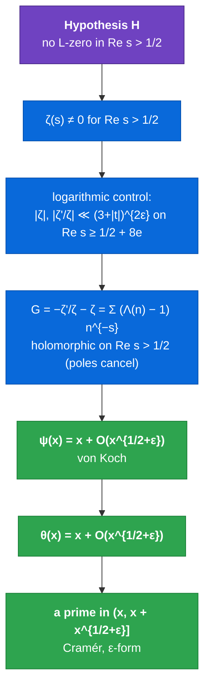

<div align="center">

# 🔢 prime-counting-rh

### Von Koch's prime-counting bound and primes in short intervals under the Riemann hypothesis

[](lean-toolchain)
[](lake-manifest.json)
[](axioms.txt)
[-d73a49)](LiouvilleEnergyRH/Hypothesis.lean)
[](Axioms.lean)
[](PrimeCounting.lean)
[](https://github.com/anaxia-research/liouville-energy-rh)

</div>

---

> **Paper.** D. Bhattacharjee and U. Bhattacharya, *The Riemann Hypothesis and Its Generalization as One Energy Bound*, preprint, 2026.
>
> **Parent repository.** [anaxia-research/liouville-energy-rh](https://github.com/anaxia-research/liouville-energy-rh), the full Lean formalization of the paper.



🟣 **Parent conjecture:** the generalized Riemann hypothesis for Dirichlet L-functions, in the form of Hypothesis H: no Dirichlet L-function vanishes in Re s > 1/2. Only its case q = 1, the Riemann hypothesis, is used here.

🎯 **Statement.** For every ε > 0:

- ψ(x) = Σ_{n≤x} Λ(n) = x + O(x^{1/2+ε}) (von Koch, 1901);
- θ(x) = Σ_{p≤x} log p = x + O(x^{1/2+ε});
- every interval (x, x + x^{1/2+ε}] with x ≥ x₀(ε) contains a prime, so p_{n+1} − p_n ≪ p_n^{1/2+ε} (Cramér, 1920, in the ε-form).

✅ **Lean 4 declarations:**

| Declaration | Statement |
|---|---|
| `LiouvilleEnergyRH.PrimeCount.psi_bound` | ζ ≠ 0 on Re s > 1/2 ⟹ \|ψ(x) − x\| ≤ K x^{1/2+η} |
| `LiouvilleEnergyRH.PrimeCount.theta_bound` | ζ ≠ 0 on Re s > 1/2 ⟹ \|θ(x) − x\| ≤ K x^{1/2+η} |
| `LiouvilleEnergyRH.PrimeCount.prime_in_short_interval` | ζ ≠ 0 on Re s > 1/2 ⟹ a prime in (x, x + x^{1/2+η}] for x ≥ x₀ |
| `LiouvilleEnergyRH.psi_bound_of_H` | Hypothesis H ⟹ ψ(x) = x + O(x^{1/2+η}) |
| `LiouvilleEnergyRH.theta_bound_of_H` | Hypothesis H ⟹ θ(x) = x + O(x^{1/2+η}) |
| `LiouvilleEnergyRH.prime_gap_of_H` | Hypothesis H ⟹ primes in every (x, x + x^{1/2+η}], x ≥ x₀ |

`lake env lean Axioms.lean` prints only `propext`, `Classical.choice` and `Quot.sound` for each (see `axioms.txt`). There is no `sorry`, `axiom` or `native_decide` in the sources. The functions ψ and θ are Mathlib's `Chebyshev.psi` and `Chebyshev.theta`.

## 🔧 Build

```
lake exe cache get
lake build
lake env lean Axioms.lean
```

Lean v4.34.1, Mathlib v4.34.1.

## 🙏 Context and credit

This is one corollary of the paper *The Riemann Hypothesis and Its Generalization as One Energy Bound* by D. Bhattacharjee and U. Bhattacharya. The full formalization is at [anaxia-research/liouville-energy-rh](https://github.com/anaxia-research/liouville-energy-rh); the zeta bounds and the smoothing argument are shared with [anaxia-research/averaged-chowla-grh](https://github.com/anaxia-research/averaged-chowla-grh). Hypothesis H is stated word for word as `DirichletLNonvanishingRightOfHalf` in L. Alpöge's Lean project (alpo.ge, November 2026). Third-party sources are listed in [`NOTICE`](NOTICE): the library `Vinogradov/` (creelie/breakthrough-problems-3, Apache 2.0), OpenAI's `LogarithmicControl.lean` (Apache 2.0), and the Selberg sieve from PrimeNumberTheoremAnd (Apache 2.0).

## 📖 Citation

```bibtex
@misc{prime-counting-rh,
  author = {Bhattacharjee, Deep and Bhattacharya, Ushashi},
  title  = {prime-counting-rh: von Koch's bound and primes in short intervals under the Riemann hypothesis, in Lean 4},
  year   = {2026},
  url    = {https://github.com/anaxia-research/prime-counting-rh}
}
```
